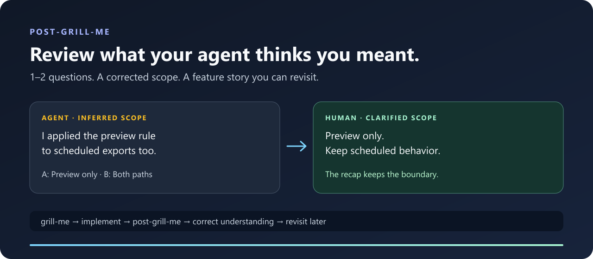

# post-grill-me

**Review what your coding agent thinks you meant.**

A lightweight companion workflow for [grill-me](https://github.com/mattpocock/skills/tree/main/skills/productivity/grill-me) users: surface the assumptions an agent adopted during the work, correct them in **1–2 questions**, and keep a feature recap you can revisit months later.

[English](README.md) · [简体中文](README.zh-CN.md) · [Quick example](#a-30-second-example) · [After grill-me](docs/after-grill-me.md)

[](https://github.com/Gsnow0123/post-grill-me/actions/workflows/validate.yml)
[](LICENSE)



## Install

Choose one instruction language. Each is a complete, standalone skill; both follow the language of your conversation.

```bash
# English instructions
npx skills add Gsnow0123/post-grill-me --skill post-grill-me

# 中文指令
npx skills add Gsnow0123/post-grill-me --skill post-grill-me-zh
```

The [Skills CLI](https://github.com/vercel-labs/skills) lets you choose the target agent. Add `-g` for a user-wide install. For manual Codex setup and release ZIPs, see [installation](docs/install.md).

In Codex:

```text
$post-grill-me Check the consequential assumptions you inferred about this change.
```

For the Chinese variant use `$post-grill-me-zh`. In clients with slash-command skill invocation, use the corresponding `/post-grill-me` command. No companion skill, API key, service, or runtime dependency is required by the workflow.

## A 30-second example

*Illustrative dialogue using a fictional export feature.*

> **Agent · inferred scope**
> I read “don't special-case archived items” as applying to every export path. Your comment was about the preview dialog; this reading would also change scheduled exports.
>
> **A.** Preview only. **B.** Preview and scheduled exports. Or rewrite the scope.
>
> **You**
> A. Keep the scheduled job's existing behavior.
>
> **Agent**
> I expanded a local instruction into a broader rule. I'll scope it to the preview and preserve the scheduled job's behavior. The recap now records that boundary.

That is the checkpoint: a consequential interpretation, its basis and effect, and an easy correction. The full feature story stays in the recap instead of turning into a long chat questionnaire.

## Already use grill-me?

```text
grill-me / grill-with-docs → implement → post-grill-me → correct understanding
                                               ↘ feature recap → revisit later
```

| Moment | Useful question |
| --- | --- |
| Clarifying an idea with grill-me | What are we trying to achieve, and which decisions remain? |
| Checking a change with post-grill-me | Which interpretations did the agent adopt, and are they what I meant? |
| Returning after a few months | Why did we change this, how does it work, and what did we clarify? |

Use it during a change whenever the agent may have overinterpreted a request; you do not have to finish implementation first. It also works when you never used grill-me. Read the [companion workflow](docs/after-grill-me.md) for a copyable hand-off prompt and a scope example.

## What makes the checkpoint useful

- **Small rounds.** One or two high-impact judgments, with short evidence and concrete alternatives. No exhaustive interview or automatic acceptance checklist.
- **Correctable assumptions.** Human intent, code behavior, and agent inference stay distinct. A confident interpretation still needs a source.
- **Several chats, several versions.** Relevant conversations can inform the recap when tools permit; newer messages and implemented code do not automatically define the final requirement. Parallel branches retain their scope.
- **A readable feature memory.** Purpose, behavior, choices, corrected misunderstandings, and source limits live in one reusable record across chats.
- **Optional desktop presentation.** Where a host exposes a right-side file panel, the recap opens there; brief questions stay in chat. A CLI can use the same workflow with a file link.

## Revisit a change

```text
$post-grill-me Refresh my memory about the export change. Start with the purpose,
current recorded behavior, and important choices. Let me choose what to expand.
```

The skill starts with 3–5 short points rather than asking you to remember every earlier decision. Historical records remain labeled by source and scope; they do not prove the present deployment or implementation.

## Choose where recaps live

Use an explicit path in your prompt, your project's existing documentation convention, or copy [.post-grill-me.example.json](.post-grill-me.example.json) to your project root as `.post-grill-me.json`:

```json
{
  "artifact_root": "docs/feature-recaps"
}
```

Relative paths resolve from that config file. If the destination is missing, the agent asks before creating it; if no destination is established, it asks once for a suitable location. It reuses the same feature record rather than creating one per chat. No personal machine path is embedded in either public skill.

## Compatibility and validation

This is an instruction-only [Agent Skill](https://agentskills.io/specification). Conversation-history access, filesystem writes, and side panels depend on the host and its permissions. It cannot retrieve inaccessible memory or update a persistent memory store merely by describing a correction. See [capabilities](docs/compatibility.md).

Package checks validate the two skill folders, metadata, local links, release contents, and publication hygiene. [Behavior cases](evals/README.md) are supplied for manual regression testing; no model pass rate or broad client certification is claimed. The examples are illustrative, not benchmark results.

## Contribute

Useful reports include a sanitized instruction, what the agent inferred, your correction, and the host used. Help keep the English and Chinese versions aligned. See [contributing](CONTRIBUTING.md).

## Inspiration

The name and interview idea are inspired by Matt Pocock's [grill-me / grilling](https://github.com/mattpocock/skills). This is an independently authored companion project, with its own scope and no dependency on that repository. Packaging references include [Superpowers](https://github.com/obra/superpowers), the [Agent Skills standard](https://agentskills.io/specification), and [Vercel's Skills CLI](https://github.com/vercel-labs/skills). No affiliation or endorsement is implied.

If this helps you catch an assumption you would otherwise miss, a star or a sanitized example helps others discover it.

MIT · [Changelog](CHANGELOG.md)
